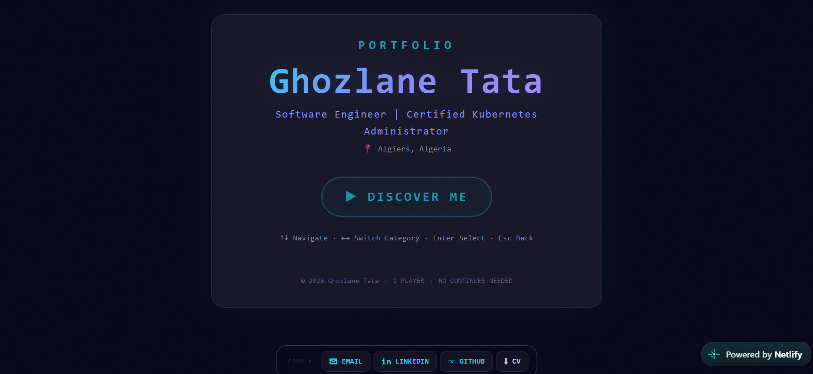
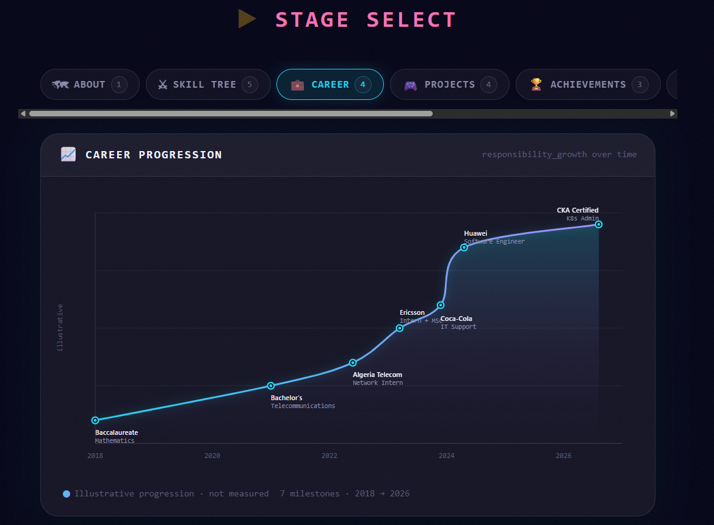
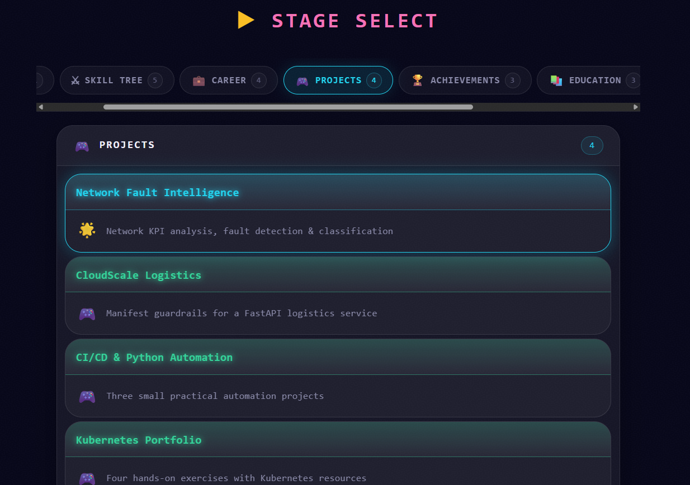

# ✦ AURORA ARCADE ✦
### A portfolio, reimagined as an adventure.

<p align="center">
  
  
  
</p>

<p align="center">
  <strong>Not just a portfolio. A little universe of my own.</strong>
  <br />
  A place where software engineering meets imagination, where an aurora lights the way, and where discovering my work feels a little more like playing a game.
</p>

<p align="center">
  🌌 <a href="https://ghozlanetata.netlify.app"><strong>ENTER AURORA ARCADE</strong></a>
  &nbsp; · &nbsp;
  🪞 <a href="https://ghozlanetata.netlify.app/classic-portfolio">Explore the Classic Experience</a>
</p>

---

## 🌌 The idea behind the experience

I have always been drawn to the atmosphere of the aurora: its shifting colors, luminous gradients, and the way light moves across a dark sky. I wanted to bring that feeling into something personal.

But I didn't want another portfolio that simply lists skills, projects, and experience.

**I wanted people to explore.**

That idea became **Aurora Arcade**: an RPG-inspired portfolio where I am the character, my professional journey is part of the adventure, and every section offers another way to discover what I do.

The visual identity takes inspiration from the aurora's colors and motion. The interaction design takes inspiration from arcade and role-playing games. Together, they create a more playful way to tell a professional story.

And because creativity doesn't mean sacrificing clarity, there is also a classic portfolio experience for visitors who prefer a more traditional layout.

Two experiences. One story. ✨

## 🎮 Choose your experience

<table>
  <tr>
    <td width="50%" valign="top">
      <h3>🌠 The Aurora Arcade</h3>
      <p>The creative experience.</p>
      An RPG-inspired interface that invites visitors to explore my professional identity, projects, career journey, and contact information through a more immersive visual experience.
      <p><strong>Explore →</strong> <a href="https://ghozlanetata.netlify.app">Launch the arcade</a></p>
    </td>
    <td width="50%" valign="top">
      <h3>🪞 The Classic Portfolio</h3>
      <p>The conventional experience.</p>
      A more familiar presentation of my professional background and work, with its own purple-and-pink visual identity.
      <p><strong>Explore →</strong> <a href="https://ghozlanetata.netlify.app/classic-portfolio">View the classic version</a></p>
    </td>
  </tr>
</table>

### ✨ One of my favorite details

The transition between the two experiences is inspired by an **aurora curtain** — a visual passage that connects two different interpretations of the same portfolio.

Rather than treating the classic version as a separate, disconnected page, the transition makes switching experiences part of the journey.

## 📸 A glimpse inside

<!-- Add your screenshots to docs/screenshots/ using the filenames below. -->

<p align="center">
  
  <br />
  <em>The entrance to the arcade.</em>
</p>

<p align="center">
  
  <br />
  <em>My professional journey, told visually.</em>
</p>

<p align="center">
  
  <br />
  <em>The projects behind the character.</em>
</p>

<p align="center">
  <a href="PASTE-YOUR-PORTFOLIO-DEMO-VIDEO-LINK-HERE"><strong>▶ Watch the full portfolio walkthrough</strong></a>
</p>

## 🧩 More than a visual experiment

Behind the atmosphere is a real software engineering project.

- **Dual experiences:** A creative arcade-inspired portfolio and a classic alternative.
- **Custom visual identity:** Aurora-inspired color, lighting, motion, and transitions.
- **Professional journey:** An engaging presentation of my experience and career progression.
- **Project showcase:** A dedicated space for engineering projects, technical work, and demonstrations.
- **Certifications and skills:** A structured view of my technical development.
- **Contact and professional links:** Clear paths to connect beyond the experience.

The goal was to build something that feels personal without compromising usability or the substance of the work it presents.

## 🛠️ Under the hood

<p>
  
  
  
  
  
</p>

| Technology | Role |
|---|---|
| Next.js | Application framework and routing |
| React | Component-based user interface |
| TypeScript | Type-safe application development |
| Tailwind CSS | Styling and responsive layouts |
| Netlify | Production deployment |

## 🚀 Run it locally

### Prerequisites

- Node.js
- npm
- Git

### Installation

```bash
git clone https://github.com/ghozlanetata/aurora-arcade-portfolio.git
cd aurora-arcade-portfolio
npm install
npm run dev
```

Open [http://localhost:3000](http://localhost:3000) in your browser.

To create and run a production build:

```bash
npm run build
npm run start
```

## 🪄 Why Aurora Arcade?

Because a portfolio can be more than a digital résumé.

It can be an experiment in interaction, a visual expression of personality, and a way to bring together the things that inspire us with the work we do.

Aurora Arcade is my attempt to do exactly that: combine my love of atmospheric visuals, video-game aesthetics, and software engineering into one cohesive experience.

**Built with code. Inspired by the aurora. Designed to be explored.** 🌌

---

## 👩‍💻 About the creator

**Ghozlane Tata**  
Software Engineer · Certified Kubernetes Administrator (CKA)

I work across software delivery, Kubernetes, DevOps, networking, and system integration. Aurora Arcade is a personal project that gives me room to explore a different side of engineering: building experiences that are technically grounded, visually expressive, and distinctly my own.

<p align="center">
  <a href="https://ghozlanetata.netlify.app">Portfolio</a>
  &nbsp; ✦ &nbsp;
  <a href="https://github.com/ghozlanetata">GitHub</a>
  &nbsp; ✦ &nbsp;
  <a href="https://www.linkedin.com/in/ghozlane-tata-911811273/">LinkedIn</a>
</p>

<p align="center">
  <sub>Thanks for exploring my little corner of the universe. ✨</sub>
</p>
